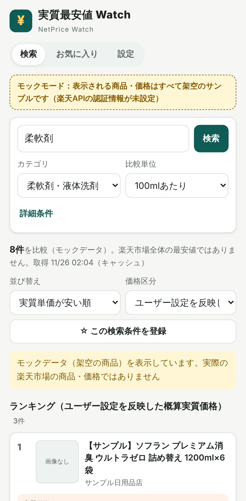
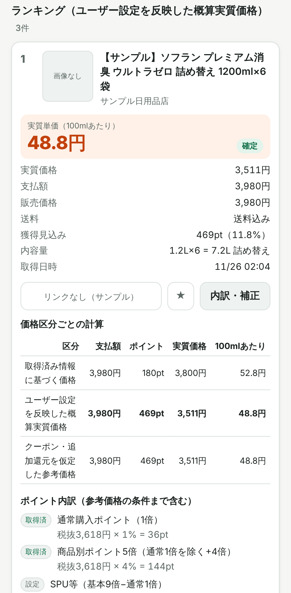
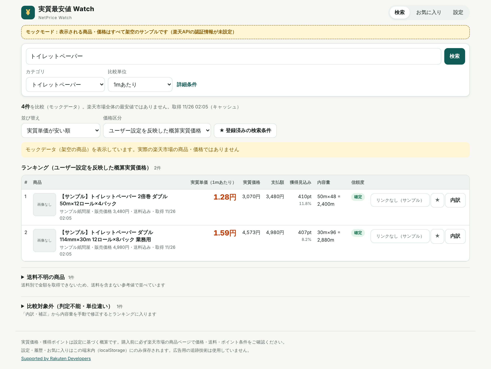

# 実質最安値 Watch（NetPrice Watch）

楽天市場の商品を、**販売価格だけでなくポイント還元・送料・クーポン・内容量・セット個数を考慮した「実質単価」**で比較する個人用 Web アプリです。

- 楽天市場 商品検索 API（公式）を使用。スクレイピングはしません
- 容量解析・ポイント計算・ランキングはすべて通常のプログラム（生成 AI API は不使用）
- Cloudflare Workers（無料枠）で動作、月額固定費 0 円を想定
- PC は比較表、スマートフォンはカード表示（横スクロールなし）
- 楽天 API の認証情報が無い間は **モックモード**（架空のサンプル商品、画面上部に常時表示）

| スマートフォン：検索結果 | ポイント内訳 | PC：比較表 |
|---|---|---|
|  |  |  |

## 主な機能

- 検索条件: キーワード / 除外キーワード / 価格範囲 / 送料込みのみ / 在庫ありのみ / 店舗コード / 最低ポイント倍率 / 取得件数（最大 90 件）/ 本体・詰め替え / 最低内容量
- 容量解析: `1200ml×6袋`、`1.2L 詰替え 6袋入り`、`50m×12ロール×4パック`、`500ml×24本×2ケース` 等。信頼度（確定・要確認・判定不能）付き。手動補正可
- 実質価格: 基本倍率（初期 9 倍、通常 1 倍を含む）、SPU 追加、買い回り、日付キャンペーン、スーパーDEAL、店舗独自ポイント、クーポン、上限・残り上限、ポイント評価額、税率
- 3 区分表示: 取得済み情報に基づく価格 / ユーザー設定を反映した概算 / クーポン等を仮定した参考価格
- ランキング: 実質単価・実質総額・支払額・還元率・レビュー・内容量。単位の異なる商品・送料不明の商品は別枠
- お気に入り（検索条件・商品）、目標単価、一括再検索、検索履歴、設定の端末内保存

## クイックスタート（ローカル）

```bash
npm install
npm run build
npx wrangler dev --port 8787 --var ENVIRONMENT:development --var AUTH_MODE:none
# → http://localhost:8787 （認証情報が無いのでモックモード）
```

フロントエンドを HMR で開発する場合は、`npm run dev:worker`（別ターミナルで `.dev.vars` を用意）と `npm run dev` を同時に起動します（Vite が `/api` を 8787 へ中継）。

実 API を使う場合は `.dev.vars.example` を `.dev.vars` にコピーし、楽天のアプリ ID・アクセスキー・Referer を設定します（`.dev.vars` は Git 管理外）。

## デモ版（ブラウザ内のみ・モックデータ）

`npm run build:demo` で、サーバーなしでブラウザ内だけで動く 1 ファイルのデモ（`dist/demo-artifact.html`）を生成します。
架空のサンプル商品のみを使い、楽天 API には接続しません。

## コマンド

| コマンド | 内容 |
|---|---|
| `npm run typecheck` | TypeScript 型チェック |
| `npm run lint` | ESLint |
| `npm test` | 単体テスト（Vitest） |
| `npm run build` | 型チェック＋フロントエンドビルド |
| `npm run test:e2e` | E2E（Playwright。ビルドして wrangler dev を起動） |
| `npm run check` | 上記すべて＋配信物の秘密情報・生成 AI 参照チェック |
| `npm run deploy` | ビルドして Cloudflare にデプロイ（**本番デプロイは承認後に実施**） |

## 環境変数

| 名前 | 種別 | 説明 |
|---|---|---|
| `RAKUTEN_APPLICATION_ID` | secret | 楽天アプリ ID |
| `RAKUTEN_ACCESS_KEY` | secret | 楽天アクセスキー |
| `RAKUTEN_AFFILIATE_ID` | secret（任意） | 楽天アフィリエイト ID |
| `RAKUTEN_REFERER` | var | 楽天のアプリ登録で許可したサイト URL |
| `RAKUTEN_ENDPOINT` | var（任意） | API エンドポイントの上書き |
| `RAKUTEN_ACCESS_KEY_TRANSPORT` | var（任意） | `query`（既定）/ `header` |
| `AUTH_MODE` | var | `access`（推奨）/ `token` / `none`（development のみ） |
| `ACCESS_TEAM_DOMAIN`, `ACCESS_AUD` | var | Cloudflare Access 利用時 |
| `APP_ACCESS_TOKEN` | secret | `AUTH_MODE=token` 時の共有トークン（16 文字以上） |
| `DATA_MODE` | var | `auto`（既定）/ `mock` / `live` |
| `CACHE_TTL_SECONDS` | var | 検索結果キャッシュ秒数（既定 600、最大 3600） |
| `SEARCH_LIMIT_PER_MINUTE` | var | 1 利用者・1 分あたりの検索上限（既定 20） |

## ドキュメント

- [docs/architecture.md](docs/architecture.md) — 構成と設計判断
- [docs/rakuten-api.md](docs/rakuten-api.md) — 楽天 API の仕様・制約・**未確認事項**
- [docs/calculation-rules.md](docs/calculation-rules.md) — 実質価格・ポイント・容量解析のルール
- [docs/deployment.md](docs/deployment.md) — デプロイ、アクセス制限、無料枠
- [docs/roadmap.md](docs/roadmap.md) — 価格監視・通知・収益化の計画

## 注意事項

- 表示される実質価格・獲得ポイントは設定に基づく概算です。購入前に楽天市場の商品ページで確認してください。
- 検索結果は楽天 API の検索結果上位（最大 90 件）のみを比較しており、楽天市場全体の最安値ではありません。
- 送料別の商品は送料額を API で取得できないため「送料不明」として別枠表示します（送料無料とはみなしません）。
